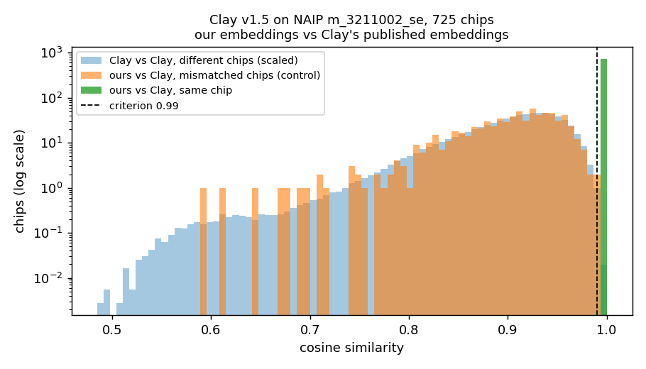

# Clay v1.5 — Reproducible Embedding Inference on PACE ICE

This guide reproduces inference with the released
[Clay v1.5](https://github.com/Clay-foundation/model) foundation model on
Georgia Tech's PACE ICE cluster, and validates the output against the
embeddings that Clay published for the same input.

**Result.** For all 725 chips of NAIP tile `m_3211002_se_12_1_20150530`, the
embeddings produced here match Clay's published embeddings with a mean cosine
similarity of **0.99999995** (minimum 0.99999992). The pass criterion is a
mean of at least 0.99.

| | |
|---|---|
| Model | Clay v1.5, `clay-v1.5.ckpt` ([Hugging Face](https://huggingface.co/made-with-clay/Clay)), source at commit `f14e698` |
| Input | one NAIP aerial image (Arizona, 2015-05-30, 4 bands, 1 m) from Microsoft Planetary Computer |
| Reference | Clay's published v1.5 NAIP embeddings for the same image ([source.coop](https://source.coop/clay/clay-v1-5-naip-2)) |
| Platform | PACE ICE, Slurm; 1× NVIDIA L40S for inference |
| Reference run | 2026-10-11, Slurm jobs 6194941–6194944; logs and outputs in [`benchmarks/results/clay/`](../../../../benchmarks/results/clay/) |
| Related files | [`model.yaml`](model.yaml) · [recipe](../../../../recipes/clay-inference-embeddings.yaml) · [resource profile](../../../../resource-profiles/pace-ice/coc-gpu-l40s.yaml) · [run record](../../../../benchmarks/results/clay/clay-pace-ice-inference.yaml) · tracking issue [#8](https://github.com/cyber-shuttle/cybershuttle-ai4science-foundry/issues/8) |

## Contents

1. [Background](#1-background)
2. [Repository layout](#2-repository-layout)
3. [Requirements](#3-requirements)
4. [Quick start](#4-quick-start)
5. [Setup](#5-setup)
6. [Running the workflow](#6-running-the-workflow)
7. [Checking your results](#7-checking-your-results)
8. [Validation of the reference run](#8-validation-of-the-reference-run)
9. [Configuration and provenance](#9-configuration-and-provenance)
10. [Running the embedding script directly](#10-running-the-embedding-script-directly)
11. [Troubleshooting](#11-troubleshooting)
12. [Cleanup](#12-cleanup)

## 1. Background

### 1.1 The model

Clay v1.5 is a foundation model for Earth observation imagery: a Vision
Transformer (ViT-Large, 24 layers, width 1024) trained as a masked autoencoder
on about 70 million image chips from Sentinel-2, Landsat 8/9, Sentinel-1,
NAIP, LINZ and MODIS ([release notes](https://clay-foundation.github.io/model/release-notes/specification.html)).
For inference, only the encoder is used. Its input is one *chip*, a 256 × 256
pixel image tile, together with metadata describing the sensor, the
acquisition time and the location. Its output used here is the *class
embedding*: a vector of 1,024 numbers that summarizes the chip. Embeddings of
similar places are close to each other, which is what makes them useful for
search, change detection and downstream models.

### 1.2 What is reproduced and how it is checked

Clay ran its model over most of the US NAIP aerial image archive and published
the resulting embeddings. This workflow takes one of those images, runs the
same checkpoint on it independently, and compares the two sets of embeddings
chip by chip. Clay's published embeddings serve as the reference (the "answer
key"). Matching them shows that every part of this setup is the same as
Clay's: software, weights, input pixels, chip boundaries, and the way metadata
is encoded.

The comparison uses cosine similarity, cos(a, b) = a·b / (‖a‖ ‖b‖), which is
1 when two embeddings point in the same direction. **Pass criterion: the mean
cosine similarity between our embedding and Clay's embedding of the same
chip, over all 725 chips, is at least 0.99.** This criterion was set in
Assignment 1; Clay does not define one. Section 8 describes two controls that
rule out a high score caused by chips simply resembling each other.

This is a reproduction of Clay's inference, not an evaluation of how useful
the embeddings are for a downstream task.

## 2. Repository layout

All files below were added by this contribution. Large files (environment,
model weights, imagery, embeddings) are not stored in the repository; they are
created in a work folder on scratch storage (Section 2.2).

### 2.1 Files in the repository

| Path | Role |
|---|---|
| `registry/models/earth-science/clay/README.md` | this guide |
| `registry/models/earth-science/clay/model.yaml` | registry entry for Clay v1.5 (foundry model schema) |
| `recipes/clay-inference-embeddings.yaml` | machine-readable recipe: steps, scripts, inputs, outputs, resources, verification |
| `resource-profiles/pace-ice/coc-gpu-l40s.yaml` | hardware and Slurm settings of the PACE ICE GPU used |
| **Scripts** (`scripts/`) | |
| `clay_common.sh` | shared settings sourced by all scripts: paths, pinned versions, URLs, sha256 checksums, cache locations, helper functions |
| `clay_preflight.sh` | login-node check before submitting (Slurm account, partitions, `sbatch --test-only`, module, scratch, network); submits nothing |
| `clay_run_all.sh` | runs the preflight, then submits the four jobs below as one dependency chain |
| `clay_build_env.sbatch` | job 1 (CPU): builds the conda environment and records the installed packages |
| `clay_environment.yml` | conda part of the environment: Python 3.11.17 and pip 26.2.1 only |
| `clay_requirements.txt` | pip lock file: 106 packages, each pinned to one version and sha256 hash |
| `clay_requirements.in` | the short list of top-level packages the lock file was generated from |
| `clay_check_env.py` | checks the installed versions against the lock file and that all imports work |
| `clay_download.sbatch` | job 2 (CPU): runs the two download scripts below |
| `clay_download_weights.sh` | downloads the Clay checkpoint and caches the DINOv2 teacher model; verifies sha256 |
| `clay_download_data.sh` | downloads the NAIP image and Clay's published embeddings; verifies sha256 |
| `clay_smoke_test.sbatch` | job 3 (GPU): smoke test on 8 chips |
| `clay_inference.sbatch` | job 4 (GPU): embeds all 725 chips and runs the validation |
| `clay_embed.py` | computes Clay embeddings for the chips of an image |
| `clay_validate.py` | smoke checks and the comparison against Clay's published embeddings |
| **Evidence** (`benchmarks/results/clay/`) | |
| `clay-pace-ice-inference.yaml` | run record of the reference run: hardware, software, runtimes, memory, results |
| `logs/<job-name>-<jobid>.out`, `.err` | complete output and error streams of the four reference-run jobs, including the ICE resource summary |
| `logs/run_all-<date>.txt` | job IDs, code version and settings of the reference run |
| `logs/troubleshooting/` | logs of problems found during development (Section 11) |
| `outputs/env/` | `pip-freeze.txt` and `conda-env-export.yml`: the exact installed packages |
| `outputs/checksums.sha256` | sha256 of every downloaded file |
| `outputs/naip_item.json` | catalog (STAC) record of the input image |
| `outputs/smoke/validation_report.json` | smoke test results |
| `outputs/inference/validation_report.json` | all validation checks with expected and observed values |
| `outputs/inference/validation_cosine.png` | histogram of the cosine similarities |
| `outputs/inference/summary.txt` | the validation result in one line |
| `outputs/inference/embed_run.json` | model inputs, software versions, GPU and timing of the inference run |
| `outputs/inference/embeddings_sample.parquet` | the first 16 of the 725 embeddings |

### 2.2 Work folder (created by the jobs, not in the repository)

All large files go under `$CLAY_WORKDIR`, which defaults to `~/scratch/clay`.
Scratch is used because the ICE home quota is 30 GB (scratch: 300 GB). A
complete run uses about 15 GiB.

```
$CLAY_WORKDIR/
├── clay-model/   Clay source code at commit f14e698 (provides configs/metadata.yaml)
├── envs/clay/    conda environment (6.0 GiB)
├── weights/      clay-v1.5.ckpt (4.9 GiB)
├── data/         NAIP image (.tif) and Clay's published embeddings (.parquet)
├── cache/        pip, conda, Hugging Face (DINOv2 teacher, 1.2 GiB), matplotlib caches
├── tmp/          temporary files
└── results/      embeddings written by the GPU jobs: smoke-<jobid>/, inference-<jobid>/
```

## 3. Requirements

- A PACE ICE account (provided through course enrollment).
- Network access to ICE: on campus, or through the Georgia Tech VPN
  (GlobalProtect, `vpn.gatech.edu`).
- A terminal on your computer: Terminal on macOS, PowerShell or Windows
  Terminal on Windows. Both provide `ssh` and `scp`. Nothing else is installed
  locally; all commands in this guide run on ICE.
- A Slurm association that can use a CPU partition and a GPU partition with an
  NVIDIA GPU (Section 5.3).
- About 15 GiB free in `~/scratch`.

## 4. Quick start

For readers who want to run first and read later. Each line is explained in
Sections 5–7.

```bash
ssh <gt-username>@login-ice.pace.gatech.edu      # from your computer
git clone --branch clay-assignment-2 https://github.com/Andy216914/cybershuttle-ai4science-foundry.git ~/clay-repro
cd ~/clay-repro
bash scripts/clay_preflight.sh                   # must end with "PREFLIGHT PASSED"
bash scripts/clay_run_all.sh                     # submits 4 jobs and returns
squeue -u $USER                                  # repeat until no clay-* jobs are listed (~15 min plus queue)
cat benchmarks/results/clay/outputs/inference/summary.txt
```

## 5. Setup

### 5.1 Log in to ICE

Connect to the VPN if you are off campus, open a terminal, and run
`ssh <gt-username>@login-ice.pace.gatech.edu`. You are now on an ICE login
node. Run all following commands there.

### 5.2 Clone the repository

```bash
cd ~
git clone --branch clay-assignment-2 https://github.com/Andy216914/cybershuttle-ai4science-foundry.git clay-repro
cd clay-repro
```

The final argument names the folder `clay-repro`, so the clone does not
collide with another copy of the foundry repository. No GitHub credentials are
needed. After the pull request is merged, the same files are on the `main`
branch of `cyber-shuttle/cybershuttle-ai4science-foundry`.

**Run every command in this guide from this folder (the repository root).**
The job scripts locate their files relative to it.

### 5.3 Configure the Slurm account and run the preflight check

Slurm accepts a job only if it names an account, a QOS (quality of service)
and a partition that your user is allowed to use. The job scripts request:

| Setting | CPU jobs (1, 2) | GPU jobs (3, 4) |
|---|---|---|
| account | `coc` | `coc` |
| QOS | `coc-ice` | `coc-ice` |
| partition | `coc-cpu` | `coc-gpu` |
| GPU | — | `gpu:l40s:1` (one NVIDIA L40S) |

These values work for College of Computing course accounts. Check yours with
`sacctmgr show assoc user=$USER format=account,partition,qos` and list the
partitions with `sinfo -s`. If yours differ, set the following variables in
the same terminal before running anything else. The scripts do not need to be
edited:

```bash
export SBATCH_ACCOUNT=<account> SBATCH_QOS=<qos>                    # read by Slurm itself
export CLAY_CPU_PARTITION=<cpu partition> CLAY_GPU_PARTITION=<gpu partition>
export CLAY_GPU_GRES=gpu:<type>:1                                   # only for a different GPU type
```

`SBATCH_ACCOUNT` and `SBATCH_QOS` are standard Slurm variables that override
the `#SBATCH` lines in the scripts. The `CLAY_*` variables are passed on the
`sbatch` command line by `clay_run_all.sh` and `clay_preflight.sh`. When you
submit a job by hand, pass the partition yourself, e.g.
`sbatch -p ice-gpu scripts/clay_inference.sbatch`.

Then run the preflight check:

```bash
bash scripts/clay_preflight.sh
```

It checks, in about ten seconds and without submitting anything: the Git
branch; your Slurm associations and the account and QOS the jobs will use;
that the partitions exist; that Slurm would accept each of the four jobs
(`sbatch --test-only`); that the `miniforge/24.3.0-0` module exists; that the
work folder can be created; and that GitHub, PyPI, the PyTorch wheel index,
Microsoft Planetary Computer, Hugging Face and source.coop are reachable.

**Expected output:** `ok` or `reachable` on every line, ending with
`PREFLIGHT PASSED`. Any `FAIL` line names the problem; see Section 11.

## 6. Running the workflow

### 6.1 Overview

The workflow consists of four Slurm batch jobs. A batch job is a script that
Slurm runs on a compute node; the resources it needs (CPUs, memory, GPU, time
limit) are declared in `#SBATCH` lines at the top of the script, so no
interactive session is needed. Each job starts only after the previous one
has finished successfully.

| Job | Script | Partition | Requested resources | Time (reference run) | Purpose |
|---|---|---|---|---|---|
| 1 | `clay_build_env.sbatch` | `coc-cpu` | 4 CPUs, 16 GiB, 1 h | 10:05 | build the software environment |
| 2 | `clay_download.sbatch` | `coc-cpu` | 2 CPUs, 16 GiB, 1 h | 2:48 | download and verify all inputs |
| 3 | `clay_smoke_test.sbatch` | `coc-gpu` | 1× L40S, 4 CPUs, 32 GiB, 30 min | 1:01 | quick functional test on 8 chips |
| 4 | `clay_inference.sbatch` | `coc-gpu` | 1× L40S, 4 CPUs, 32 GiB, 1 h | 1:06 | embed all 725 chips and validate |

Each job writes its log to `benchmarks/results/clay/logs/<job-name>-<jobid>.out`
(standard output) and `.err` (standard error, empty when the job succeeds).
ICE adds a header and a footer to the `.out` file with the account,
partition, node, elapsed time and peak memory.

### 6.2 Running all jobs

```bash
bash scripts/clay_run_all.sh
```

The script runs the preflight check again, submits the four jobs as a chain
(`sbatch --dependency=afterok:<previous job>`), prints the four job IDs,
saves them with the code version in
`benchmarks/results/clay/logs/run_all-<date>.txt`, and returns. The jobs then
run without further input. **Run it once.** A second call while jobs are
still queued starts a second chain that writes to the same folders.

To repeat everything from an empty work folder (new environment and
downloads), use a new `CLAY_WORKDIR`:
`CLAY_WORKDIR=$HOME/scratch/clay-fresh bash scripts/clay_run_all.sh`.

### 6.3 What each job does

**Job 1 — Build the environment** (`clay_build_env.sbatch`)

Purpose: give every run exactly the same software. Different package versions
can change numerical results. The build runs on a compute node because ICE
login nodes stop large installations.

1. Checks that GitHub, PyPI, the PyTorch wheel index and conda-forge are
   reachable from the compute node, and stops within seconds if not.
2. Clones `Clay-foundation/model` into `$CLAY_WORKDIR/clay-model` and checks
   out commit `f14e698f3c237cabf8d28dec669a362d66625381`.
3. Loads `module load miniforge/24.3.0-0` and creates the environment
   `$CLAY_WORKDIR/envs/clay` from `scripts/clay_environment.yml`.
4. Installs `scripts/clay_requirements.txt` with
   `pip install --require-hashes --no-deps`. Every package is fixed to one
   version and one file hash, and pip does not resolve dependencies itself.
   The lock file was generated from `scripts/clay_requirements.in` with the
   `uv` command recorded in its header, using package versions as of
   2024-11-22 (the date Clay published the reference embeddings). Where
   Clay's own `environment.yml` pins a version (torch 2.4.0+cu121,
   torchvision 0.19.0+cu121, einops 0.7.x), the same version is used.
5. Installs Clay's package `claymodel` from the checked-out source.
6. Runs `scripts/clay_check_env.py` (every installed version must equal the
   lock file; all imports must work; the DINOv2 architecture must build) and
   `pip check`.
7. Writes `outputs/env/pip-freeze.txt` and `outputs/env/conda-env-export.yml`.

Expected end of the log: `ENV CHECK PASSED`, `No broken requirements found.`,
`BUILD ENV COMPLETED`. A completed environment is reused by later runs unless
`clay_environment.yml`, `clay_requirements.txt` or the Clay commit changes, in
which case it is rebuilt.

**Job 2 — Download and verify the inputs** (`clay_download.sbatch`)

Purpose: obtain each input at a fixed version and prove it is the expected
file. Every file is compared with the sha256 checksum stored in
`scripts/clay_common.sh`; on a mismatch the job stops. Files that are already
present with the correct checksum are not downloaded again.

| File (under `$CLAY_WORKDIR`) | Content | Source | sha256 |
|---|---|---|---|
| `weights/clay-v1.5.ckpt` | Clay v1.5 checkpoint, 5,158,764,629 bytes | Hugging Face `made-with-clay/Clay`, revision `70200ebc…` | `21432069…4798d0` |
| `cache/huggingface/…/model.safetensors` | DINOv2 teacher weights, 1,217,515,128 bytes | Hugging Face `timm/vit_large_patch14_reg4_dinov2.lvd142m`, revision `f3c408e7…` | `c893d722…7def27` |
| `data/m_3211002_se_12_1_20150530.tif` | input NAIP image, 188,776,628 bytes | Microsoft Planetary Computer, item `az_m_3211002_se_12_1_20150530_20151022` | `4bd22adf…79ade567` |
| `data/m_3211002_se_12_1_20150530.parquet` | Clay's published embeddings of this image (reference) | source.coop `clay/clay-v1-5-naip-2` | `a551efc2…bece54` |

The full checksums are written to `outputs/checksums.sha256` and the image's
catalog record to `outputs/naip_item.json`.

Two of these need explanation:

- **DINOv2 teacher.** Clay was trained with a second model, DINOv2, as a
  "teacher". Clay's code builds this teacher with
  `timm.create_model(..., pretrained=True)` whenever the model is loaded,
  including for inference (`claymodel/model.py`, line 388), which requires a
  download. The job caches it once so that the GPU jobs can run offline
  (`HF_HUB_OFFLINE=1`). The teacher's weights are then replaced by those in
  the checkpoint and do not affect the embeddings.
- **Source of the image.** Clay used the copy of NAIP in the AWS bucket
  `naip-analytic`, which is "requester pays" (downloads require an AWS
  account and are billed). Microsoft Planetary Computer hosts the same USDA
  images free of charge. The validation result (Section 8) shows the two
  copies produce the same embeddings.

Expected end of the log: `downloaded and verified` (or
`already present, checksum OK`) for each file, `offline load OK`,
`DOWNLOAD COMPLETED`.

**Job 3 — Smoke test** (`clay_smoke_test.sbatch`)

Purpose: confirm cheaply that the model loads and produces well-formed,
repeatable output before the full run. The job embeds the first 8 chips twice
and checks that the output has shape [8, 1024], contains no NaN or infinite
values, is identical in both runs, and differs between chips. Output:
`outputs/smoke/validation_report.json`.

Expected end of the log: four `[PASS]` lines, `VALIDATION PASS`,
`SMOKE TEST COMPLETED`.

**Job 4 — Inference and validation** (`clay_inference.sbatch`)

Purpose: produce the result. The job embeds all 725 chips
(`scripts/clay_embed.py`) and compares each embedding with Clay's published
embedding of the same chip (`scripts/clay_validate.py`; method in Section 8).

Outputs: the embeddings in
`$CLAY_WORKDIR/results/inference-<jobid>/embeddings.parquet`, and in
`outputs/inference/` the validation report, the histogram, the run details,
a 16-chip sample and the one-line summary (see Section 2.1).

Expected end of the log: five `[PASS]` lines, the summary line, and
`WORKFLOW COMPLETED  validation: PASS`.

### 6.4 Submitting jobs individually

Instead of `clay_run_all.sh`, the jobs can be submitted one at a time; wait
until each has finished before submitting the next:

```bash
sbatch scripts/clay_build_env.sbatch
sbatch scripts/clay_download.sbatch
sbatch scripts/clay_smoke_test.sbatch
sbatch scripts/clay_inference.sbatch
```

### 6.5 Monitoring jobs

```bash
squeue -u $USER                       # ST column: PD = pending, R = running; finished jobs are not listed
tail -f benchmarks/results/clay/logs/clay-inference-<jobid>.out    # follow a log; Ctrl+C stops following, not the job
sacct -j <jobid> --format=JobID,JobName,State,ExitCode,Elapsed,MaxRSS   # final state, elapsed time, peak memory
```

## 7. Checking your results

A run writes its results into your clone, replacing the copies of the
reference run committed in the repository (the copy on GitHub is not
affected). Run the following four checks from the repository root after job 4
has finished.

**7.1 Pass/fail check.** Checks the thresholds, not exact values, so small
floating-point differences on other GPU types still pass. It first confirms
that the report files were written by your run and are not the committed
copies.

```bash
python3 - <<'PY'
import json
import subprocess
from pathlib import Path

out = Path("benchmarks/results/clay/outputs")
for f in ["smoke/validation_report.json", "inference/validation_report.json"]:
    unchanged = subprocess.run(["git", "diff", "--quiet", "--", str(out / f)]).returncode == 0
    assert not unchanged, f"{f} is still the committed copy: your run did not write it. Check your job logs."
smoke = json.loads((out / "smoke/validation_report.json").read_text())
main = json.loads((out / "inference/validation_report.json").read_text())

assert smoke["result"] == "PASS", "smoke test failed"
assert main["n_chips"] == 725
assert main["matched_cosine"]["mean"] >= 0.99, main["matched_cosine"]
assert main["matched_cosine"]["mean"] > main["mismatched_cosine_control"]["mean"] + 0.05
assert main["retrieval_top1_accuracy"] >= 0.95
print(f"PASS: mean cosine {main['matched_cosine']['mean']:.8f} over {main['n_chips']} chips, "
      f"control {main['mismatched_cosine_control']['mean']:.4f}, "
      f"retrieval {main['retrieval_top1_accuracy']:.0%}, "
      f"run on {main['run']['host']} at {main['run']['started']}")
PY
```

**7.2 Comparison with the reference run.** Git shows the committed reference
values (lines starting with `-`) next to yours (`+`):

```bash
git diff benchmarks/results/clay/outputs/inference/summary.txt
```

On an L40S only the first line (job ID and code version) should differ. On
other GPU types the last digits of the scores may also differ.

**7.3 Input checksums.** Confirms that you downloaded the same files:

```bash
(cd "${CLAY_WORKDIR:-$HOME/scratch/clay}" && sha256sum -c "$OLDPWD/benchmarks/results/clay/outputs/checksums.sha256")
```

All four lines must end in `OK`.

**7.4 Histogram.** The plot is a PNG file on ICE. To view it, run the
following on your own computer (Terminal or PowerShell, VPN connected); it
copies the file into the current folder:

```bash
scp <gt-username>@login-ice.pace.gatech.edu:clay-repro/benchmarks/results/clay/outputs/inference/validation_cosine.png .
```

## 8. Validation of the reference run

### 8.1 Method

The validation has two parts.

**Smoke test (job 3).** Eight chips are embedded twice. Checks: output shape
[8, 1024]; all values finite; maximum absolute difference between the two
runs ≤ 1e-5; the closest pair of different chips differs by more than 1% of
the mean embedding norm. These confirm that the model loads, runs, is
deterministic and responds to its input.

**Main check (job 4).** For each chip *i* of the 725, let *a_i* be our
embedding and *b_i* Clay's published embedding. The checks are:

| Check | Definition | Pass condition |
|---|---|---|
| Chip correspondence | maximum distance between our chip outlines and Clay's | < 1e-9 degrees |
| Finite values | no NaN or infinity in the 725 × 1024 embeddings | true |
| **Matched cosine** | mean over *i* of cos(*a_i*, *b_i*) | **≥ 0.99** |
| Mismatched-chip control | mean of cos(*a_i*, *b_j*) for a random pairing with *j* ≠ *i* | below the matched mean |
| Retrieval | fraction of chips for which *b_i* is the most similar of all 725 reference embeddings to *a_i* | ≥ 95% |

The relative difference ‖*a_i* − *b_i*‖ / ‖*b_i*‖ is also reported.

**Why controls are needed.** All chips come from one image and resemble each
other: Clay's own embeddings of *different* chips in this image already have
a mean cosine similarity of 0.90. A high matched score is only meaningful if
it is clearly above the score for mismatched chips, and if each chip is
identified as its own match among all 725.

### 8.2 Smoke test — job 6194943

| Check | Expected | Observed |
|---|---|---|
| Checkpoint load | no missing or unexpected weights (strict loading) | loaded |
| Output shape | [8, 1024] | [8, 1024] |
| Finite values | no NaN or infinity | all finite |
| Repeatability | max \|run 1 − run 2\| ≤ 1e-5 | 0.0 |
| Input sensitivity | closest pair of different chips differs by > 1% of the norm | 16.9% |
| **Result** | | **PASS** |

Report: [`outputs/smoke/validation_report.json`](../../../../benchmarks/results/clay/outputs/smoke/validation_report.json)

### 8.3 Main check — job 6194944

| Check | Expected | Observed |
|---|---|---|
| Chip correspondence | < 1e-9° | 0.0° (all 725 chips) |
| Finite values | true | true |
| **Matched cosine similarity** | **≥ 0.99** | **0.99999995** (minimum 0.99999992) |
| Mismatched-chip control | below matched | 0.9017 |
| Retrieval | ≥ 95% | 100% (725 of 725) |
| Relative difference | (reported) | 0.03% on average |
| **Result** | | **PASS** |



The histogram (log scale) shows the 725 matched similarities (green) at 1.0,
the mismatched control (orange) and the similarities between Clay's own
embeddings of different chips (blue) spread around 0.9, and the 0.99
criterion (dashed line).

Report: [`outputs/inference/validation_report.json`](../../../../benchmarks/results/clay/outputs/inference/validation_report.json)

### 8.4 Interpretation

Clay's published embeddings are the output of the same checkpoint applied to
the same image by Clay's own pipeline. The pipeline here is independent: a
different copy of the image, its own chip extraction and input preparation,
and a different GPU. Agreement within 0.03% on every one of the 725 chips is
only possible if the weights, the pixels, the chip boundaries and every model
input are identical to Clay's. The residual difference (1 − 0.99999995) is
consistent with floating-point rounding on different hardware. The
mismatched-chip control (0.90) and 100% retrieval show that the agreement is
specific to each chip, not a consequence of chips resembling each other.

### 8.5 Limitations

- One image is tested (Arizona, 2015-05-30, 1 m resolution, UTM zone 12).
  The time and location encoding is therefore exercised for one date and one
  place. Later NAIP years are often at 0.6 m; the 1.0 m ground resolution
  from Clay's metadata was not tested on those.
- Only the NAIP sensor is tested, not Sentinel-2, Landsat or the others.
- The check establishes a faithful reproduction of Clay's inference; it does
  not measure the usefulness of the embeddings for a downstream task.

## 9. Configuration and provenance

### 9.1 Model configuration

| Parameter | Value | Source |
|---|---|---|
| Checkpoint loading | `ClayMAEModule.load_from_checkpoint(path, model_size="large", metadata_path=<absolute path>, mask_ratio=0.0, shuffle=False)`, strict | `scripts/clay_embed.py`; Clay's tutorials |
| Model call | `module.model.encoder(datacube)`; embedding = class token, output `[:, 0, :]` of shape [B, 1025, 1024] | `claymodel/model.py` |
| Masking | none (`mask_ratio=0.0`), patches kept in order (`shuffle=False`) | |
| `pixels` | 4 bands (red, green, blue, near-infrared), 256 × 256, normalized per band with the NAIP mean and standard deviation | Clay `configs/metadata.yaml` |
| `waves` | 0.65, 0.56, 0.48, 0.842 µm | Clay `configs/metadata.yaml` |
| `gsd` | 1.0 m | Clay `configs/metadata.yaml` |
| `time` | [sin w, cos w, sin h, cos h], w = 2π · ISO week / 52 (week 22), h = 2π · 12 / 24 (noon) | Clay's data preparation, see below |
| `latlon` | [sin λ, cos λ, sin φ, cos φ] of the chip center (λ longitude, φ latitude, radians) | Clay's data preparation, see below |
| Precision | float32 inputs; `torch.set_float32_matmul_precision("medium")`, set by `claymodel` on import and left unchanged | `claymodel/model.py` |
| Batch size | 16 (8 in the smoke test) | `scripts/clay_inference.sbatch` |
| Randomness | none at inference; no seed needed. Two runs gave identical output | job 3 |

The hour and the order of the location values are not documented on Clay's
dataset page. They follow Clay's data-preparation code,
[`stacchip/processors/prechip.py`](https://github.com/Clay-foundation/stacchip/blob/5660f1a5cb0fbb77b5b2d1a56648e0027e119597/stacchip/processors/prechip.py#L152-L158)
lines 152–158: noon is assumed for images without a time of day, and the
location pair is stored with longitude first. Section 11 records what happens
with other choices.

### 9.2 Chips

The image (6490 × 7570 pixels) is divided into 25 × 29 = 725 windows of
256 × 256 pixels, starting at the top-left corner; the remaining 90 pixels on
the right and 146 at the bottom are not used. `clay_embed.py` does not
compute this grid itself: it reads the outline of every chip from the
reference file, converts it to pixel coordinates, and stops if any outline
does not fall exactly on the pixel grid. Our output row *i* is therefore the
same ground area as reference row *i*.

### 9.3 Provenance

| Item | Value |
|---|---|
| Clay source | https://github.com/Clay-foundation/model, commit `f14e698f3c237cabf8d28dec669a362d66625381` (2026-03-27); Apache-2.0 for code and weights |
| Primary reference | [Clay v1.5 release notes](https://clay-foundation.github.io/model/release-notes/specification.html) (no peer-reviewed paper); 632M parameters (encoder 311M, decoder 15M, teacher 304M) |
| Checkpoint | `clay-v1.5.ckpt`, https://huggingface.co/made-with-clay/Clay, revision `70200ebcccdf67bf2a0cb9984c77ddee26c10ed2`, DOI [10.57967/hf/1537](https://doi.org/10.57967/hf/1537), 5,158,764,629 bytes, sha256 `21432069250b9b3f9a65ffd0071c5ad56b793247285ab0604edf7f531d4798d0` |
| Teacher | `vit_large_patch14_reg4_dinov2.lvd142m` (name stored in the checkpoint), https://huggingface.co/timm/vit_large_patch14_reg4_dinov2.lvd142m, revision `f3c408e77602bb412aa65fb03dfa0d5f95cb3832`, sha256 `c893d72294d4c327e631ff92f428dbc14c4f93cb5581b6c5f9d89bb5d17def27`; Apache-2.0 |
| Input image | USDA NAIP `m_3211002_se_12_1_20150530.tif`: Arizona, 2015-05-30, 4 bands, uint8, 6490 × 7570 px, 1 m, EPSG:26912. Microsoft Planetary Computer item `az_m_3211002_se_12_1_20150530_20151022`, `https://naipeuwest.blob.core.windows.net/naip/v002/az/2015/az_100cm_2015/32110/m_3211002_se_12_1_20150530.tif`, 188,776,628 bytes, sha256 `4bd22adff7877ef333561620a0b0d8e9c5da25adb9c3e131b865849679ade567`; public domain. Catalog record: [`outputs/naip_item.json`](../../../../benchmarks/results/clay/outputs/naip_item.json) |
| Reference embeddings | https://source.coop/clay/clay-v1-5-naip-2 (Clay v1.5 NAIP embeddings, revision 2), file `az/2015/100cm/rgbir_cog/32110/m_3211002_se_12_1_20150530.parquet`: 725 rows, columns `geometry` and `embeddings` (1,024 values), sha256 `a551efc22b3ab2e3f0317f9b97a821550baafcb1e0fa2bd5a36fc0c186bece54`; CC-BY-4.0 |
| Software | Python 3.11.17, torch 2.4.0+cu121 (CUDA 12.1 build, cuDNN 9.1.0), torchvision 0.19.0+cu121, lightning 2.4.0, timm 1.0.11, numpy 2.1.3, rasterio 1.4.2 (GDAL 3.9.3), claymodel 1.5.0. Full list: [`outputs/env/pip-freeze.txt`](../../../../benchmarks/results/clay/outputs/env/pip-freeze.txt); `pip check` reports no broken requirements |
| Hardware | PACE ICE; CPU jobs on `coc-cpu`; GPU jobs on `coc-gpu` with 1× NVIDIA L40S (46068 MiB, compute capability 8.9, driver 615.71.09), 4 CPU cores, 32 GiB; RHEL 9.8, glibc 2.34; `module load miniforge/24.3.0-0` (conda 23.7.4) |
| Reference run | 2026-10-11; jobs 6194941 (build), 6194942 (download), 6194943 (smoke test), 6194944 (inference); started by [`logs/run_all-20261011T202904.txt`](../../../../benchmarks/results/clay/logs/run_all-20261011T202904.txt) from a fresh clone and an empty work folder |
| Resources used | peak memory from Slurm, peak GPU memory from PyTorch: job 1 10:05, 12.0 GiB; job 2 2:48, 7.8 GiB; job 3 1:01, 14.4 GiB, 1.63 GB GPU; job 4 1:06, 7.6 GiB, 2.01 GB GPU, 12.2 s to embed 725 chips (about 59 chips/s). 0.04 GPU-hours in total; 15 GiB of scratch |
| Code version | every log prints the Git hash of the `scripts/` folder; compare with `git rev-parse HEAD:scripts` |

## 10. Running the embedding script directly

`scripts/clay_embed.py` can embed any NAIP image for which Clay published
embeddings, since it takes the chip positions from Clay's file. It requires a
GPU, so first start an interactive session on a GPU node. The session holds
the GPU, and counts against your GPU-hour limit, until you type `exit`. Adjust
the account, QOS and partition as in Section 5.3. (The reference run used only
batch jobs; this interactive command was not part of it.)

```bash
srun -A coc --qos=coc-ice -p coc-gpu --gres=gpu:l40s:1 -c 4 --mem=32G -t 00:30:00 --pty bash
```

Then, from the repository root, after jobs 1 and 2 have completed:

```bash
source scripts/clay_common.sh && clay_activate && export HF_HUB_OFFLINE=1
python scripts/clay_embed.py \
    --tile "$CLAY_DATA/$NAIP_TILE_NAME" --reference "$CLAY_DATA/$REF_NAME" \
    --checkpoint "$CLAY_WEIGHTS/clay-v1.5.ckpt" \
    --metadata "$CLAY_REPO/configs/metadata.yaml" \
    --out "$CLAY_RESULTS/my-run/embeddings.parquet"
```

Options: `--limit N` (first N chips only), `--batch-size`, `--device`, and
`--dry-run` (prepares every input without loading the model; no GPU needed).
`python scripts/clay_embed.py --help` documents every input and output.

The output Parquet file has one row per chip with the columns `chip_index`,
`row_off` and `col_off` (position in the image), `geometry` (chip outline as
WKB, longitude/latitude) and `embeddings` (1,024 float32 values). The run
details are stored in the file metadata under `clay_run` and in a `.json` file
next to it.

## 11. Troubleshooting

Problems encountered while building this workflow are listed first, with
their logs in
[`benchmarks/results/clay/logs/troubleshooting/`](../../../../benchmarks/results/clay/logs/troubleshooting/).

**Embeddings close to Clay's but not equal (mean cosine about 0.97).**
Observed in the first full run (job 6189009,
[`clay-inference-6189009.out`](../../../../benchmarks/results/clay/logs/troubleshooting/clay-inference-6189009.out)).
That run took the hour from the image timestamp (stored as 00:00, so 0) and
ordered the location as latitude first, as Clay's example notebooks do; the
mean cosine similarity was 0.968. With the hour set to 12 and longitude first,
as in Clay's data-preparation code (Section 9.1), the same job matched Clay
(the log prints the score rounded to 1.0). `clay_embed.py` uses Clay's
data-preparation settings. If the time or location encoding is changed, check
it against that source.

**Preflight or download job reports Planetary Computer as unreachable.**
Observed in the first preflight run
([`preflight-836cb46-planetary-computer-502.txt`](../../../../benchmarks/results/clay/logs/troubleshooting/preflight-836cb46-planetary-computer-502.txt)).
The network was working: the check requested a single byte (an HTTP range
request), which the Planetary Computer catalog answers with error 502.
`clay_check_url` in `clay_common.sh` now retries with a normal request.

**Download job close to its memory limit.** Job 6188620
([`clay-download-6188620.out`](../../../../benchmarks/results/clay/logs/troubleshooting/clay-download-6188620.out))
requested 8 GiB and peaked at 7.5 GiB (94%) while building the DINOv2 teacher
model to cache it. The job now requests 16 GiB (reference run: 7.8 GiB peak).

**Clay's documentation does not match its code.** `docs/getting-started/basic_use.md`,
`quickstart.md` and `migration-guide.md` call `model.encoder(chips, timestamps,
wavelengths)`, and the first two convert wavelengths to nanometers. The
working call is `model.model.encoder(datacube)` with a dictionary (`pixels`,
`time`, `latlon`, `gsd`, `waves` in micrometers); it returns four values, and
the embedding is `[:, 0, :]` of the first. `docs/tutorials/inference.ipynb`
imports `ClayMAEModule` from `claymodel.model` (it is in `claymodel.module`)
and loads the older v1 checkpoint. `clay_embed.py` follows the code.

The following are errors you may encounter and their causes.

**`PREFLIGHT FOUND PROBLEMS` / `FAIL` lines.** The line names the problem: an
unknown partition or a rejected test submission means the Slurm settings do
not match your account (Section 5.3); an unreachable site means a network
issue; a missing module means the ICE software stack changed (check
`module spider miniforge`).

**`Invalid account or account/partition combination` or
`Invalid qos specification`.** Your Slurm association differs from the
scripts' defaults; see Section 5.3. (Submitting with `-A coe-gpu`, for
example, gives "Invalid qos specification".)

**A job waits with reason `DependencyNeverSatisfied`.** The previous job in
the chain failed, so this one will never start. Cancel it with
`scancel <jobid>`, read the failed job's `.out` and `.err` files, fix the
cause, and submit again.

**`ERROR: missing … Run: sbatch scripts/clay_download.sbatch` or
`ERROR: no finished environment`.** Jobs 1 and 2 have not completed for this
`CLAY_WORKDIR`. Run them (or `clay_run_all.sh`) and check their logs.

**A GPU job fails while building the teacher (offline mode or
`LocalEntryNotFoundError`).** The GPU jobs run without internet access
(`HF_HUB_OFFLINE=1`) and read the teacher from
`$CLAY_WORKDIR/cache/huggingface`. Run job 2 first with the same `CLAY_WORKDIR`.

**`FileNotFoundError: configs/metadata.yaml`.** The checkpoint stores this
path as a relative path. Pass the absolute path
(`--metadata $CLAY_WORKDIR/clay-model/configs/metadata.yaml`), as the job
scripts do.

**GPU errors such as `no kernel image is available` or
`CUBLAS_STATUS_ARCH_MISMATCH`.** Always request a specific GPU type. torch
2.4.0+cu121 supports compute capabilities 5.0 to 9.0. Do not use `gpu:mi210`
(AMD, no CUDA) or the RTX Pro 6000 Blackwell nodes (too new for this build).
An A100 (`gpu:a100:1`) is expected to work but was not tested.

**`Disk quota exceeded`.** A program is writing to the home folder. Keep
`CLAY_WORKDIR` on scratch; `clay_common.sh` directs pip, conda, Hugging Face,
PyTorch, matplotlib and temporary files there.

**`MKL_INTERFACE_LAYER: unbound variable` or `mkdir: Permission denied` in a
job.** Known ICE issues that the scripts avoid (conda activation is wrapped in
`set +u`; paths are taken from `$SLURM_SUBMIT_DIR`, not `${BASH_SOURCE[0]}`).
Make sure jobs are submitted from the repository root.

## 12. Cleanup

The large files are all in the work folder (about 15 GiB). To remove them:

```bash
rm -rf "${CLAY_WORKDIR:-$HOME/scratch/clay}"
```

To remove only part of it:

```bash
W=${CLAY_WORKDIR:-$HOME/scratch/clay}
rm -rf $W/results            # embeddings from your runs
rm -rf $W/cache $W/tmp       # caches; the GPU jobs need cache/huggingface, which job 2 restores
rm -rf $W/envs/clay          # the environment; job 1 rebuilds it
rm -rf $W/weights $W/data    # the downloads; job 2 fetches them again
```

To remove the clone: `rm -rf ~/clay-repro`. Conda also records the
environment's folder as one line in `~/.conda/environments.txt`; delete that
line as well to leave nothing behind.
